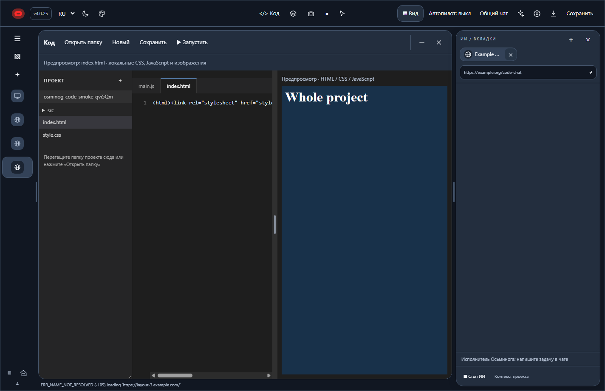

# 4.0.25 — project folder editor and native chat visibility

Source: PR [66](https://github.com/jeep-jim/OSMINOG/pull/66).

## Use

Open **Код → Открыть папку** or drag a folder onto the Code workspace. The explorer reads directories as they are expanded; opening a project does not recursively load all files into memory. Select files to open editor tabs. **Сохранить / Ctrl+S** writes the selected UTF-8 source back into its original folder, rejecting a save if another program changed the file. **Последняя папка** reopens the last selected location.

**Запустить** previews the selected HTML file, or root `index.html`, with relative CSS, JS and images. Save modified files first. The preview runs inside the existing sandbox iframe, without Node or main-frame IPC access. A project-scoped URL serves only files inside the selected root; changing roots invalidates the old token.

The UI shows a project tree, file tabs, line numbers, a resizable explorer, and the existing central editor/preview divider. Minimize retains the editor and preview.

## Deliberate limits

This is a folder-based source editor, not all of VS Code. ZIP import/export, terminal, LSP, extension ecosystem, automatic package installation and React/TypeScript build execution are not included. Such source files can be read/edited; raw TSX is not rendered as if it were HTML. Open the built HTML output for static preview. Files over 8 MiB and non-UTF-8/binary files are shown read-only with a message, remain on disk unchanged. Preview assets are limited to 32 MiB per file. Network requests from preview are disabled. Directories linked outside the selected root are not followed.

## Verification

- Local configured test suite excluding socket-based MCP tests: 155 passed. New tests cover nested files, binary preservation, external-edit conflicts, path confinement, preview scope/token revocation, and iframe navigation not hiding the native chat.
- An extra exploratory run of `shell-ui.test.cjs` (not in the configured npm suite) did not finish locally and was interrupted; no success claimed for that run.
- Windows workflow: https://github.com/jeep-jim/OSMINOG/actions/runs/39029132968
- Agent regression: https://github.com/jeep-jim/OSMINOG/actions/runs/39029132971
- Windows shell smoke creates a real temporary project, edits nested JS, checks disk content, executes linked JS through the preview URL, and verifies that the native right-side view remains visible with the same webContents across preview and minimize/restore.
- Chat fix: the former global `did-start-loading` handler hid views during child iframe loads. Now only a main-frame document navigation clears the layout. This addresses that reproducible cause; it does not claim to eliminate every possible remote-provider/network issue.

Published: release workflow 39029746520 passed UPDATE_INSTALL_STARTED and INSTALLED_UPDATE_SMOKE_PASS 4.0.25. Both update feeds point to 4.0.25. Installer: 115252731 bytes, SHA-256 ca8987b44f98fbf8504b0fdad6c88e1307f6dbee67b600e9d95e5af6fc5c94ac. See release-windows.log.

Windows candidate completed successfully, including installed folder/preview/chat checks and ordinary installed launch. All 160 configured Windows tests passed. Merge: `13d8100ecfd3b574cb0424ef3fe8316f87dbd7ba`. Runtime source `4bd5cff94e8b02adf8ff220f0c5c0b4fbafed69a` has the same complete blob tree as the merge.

The screenshot is captured from the shell webContents; separate native website views are not evidence of remote-provider content in this image. Native view visibility and identity are asserted separately by the Windows test.
